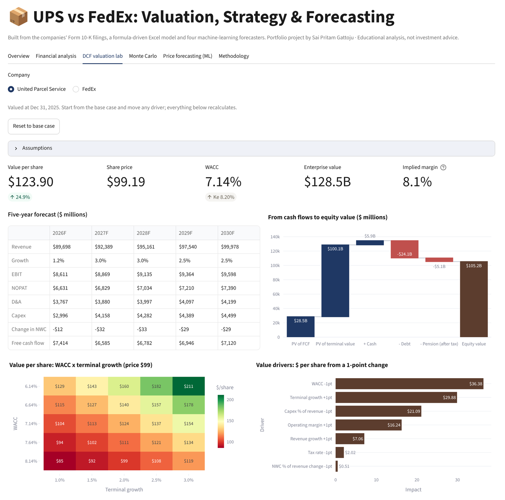
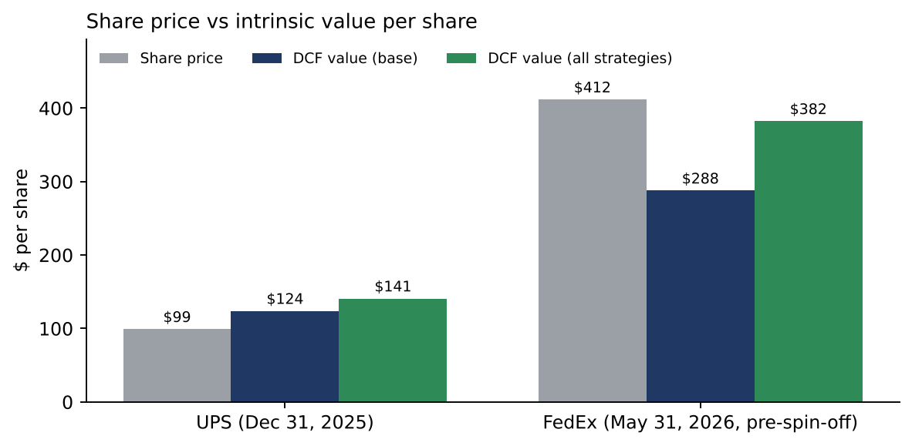
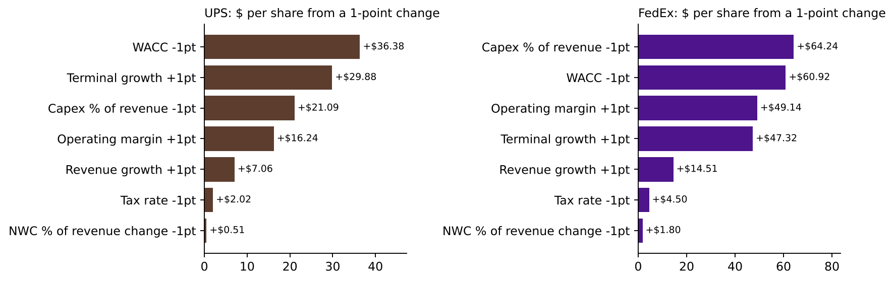
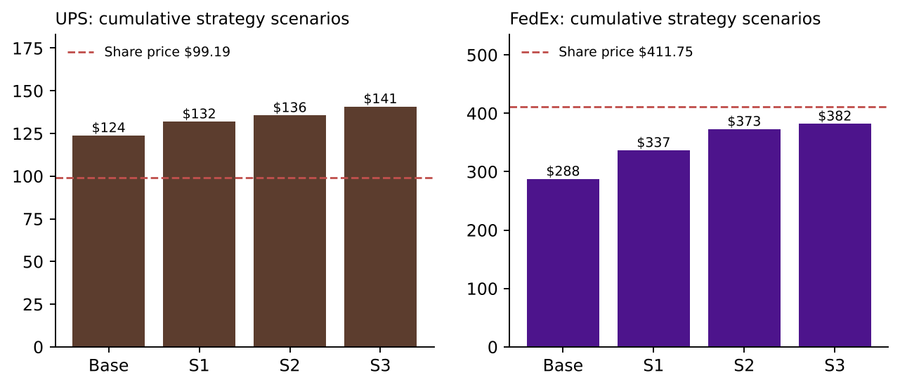
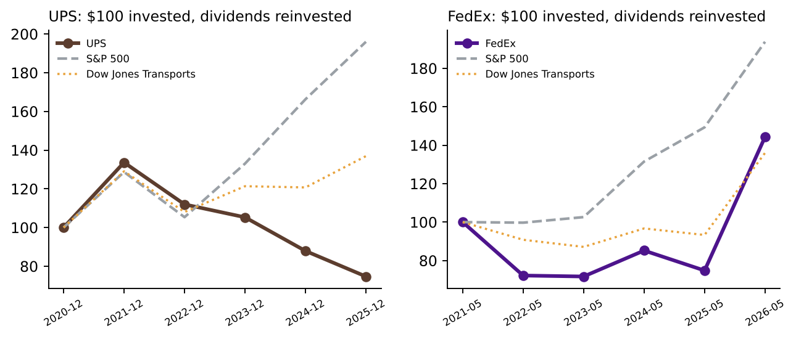
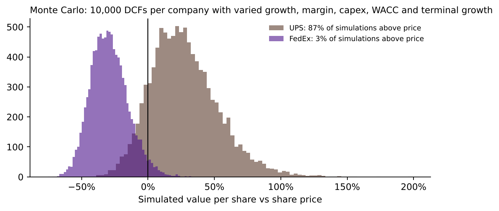

# UPS vs FedEx: Valuation, Strategy & Forecasting

**An end-to-end equity research project on the two largest U.S. parcel carriers.** It is built from their Form 10-K filings, with a formula-driven Excel valuation model, an 8-page strategy report, a Python DCF engine with Monte Carlo simulation, four machine-learning price forecasters and an interactive Streamlit dashboard.

[](https://colab.research.google.com/github/pritam-gattoju/ups-vs-fedex-valuation-forecasting/blob/main/notebooks/01_market_data_and_ml_forecasting.ipynb)
&nbsp;**▶ Live dashboard: [pritam-ups-fedex-valuation.streamlit.app](https://pritam-ups-fedex-valuation.streamlit.app)**


*The DCF valuation lab: move any assumption and the forecast, valuation, sensitivity table and value drivers update instantly.*

## The question

Are UPS and FedEx shares priced above or below what their cash flows justify? Which assumptions drive that answer, and which strategic moves would add the most value per share?

## Key findings

| | **UPS** (Dec 31, 2025) | **FedEx** (May 31, 2026, pre-spin-off) |
|---|---|---|
| Share price | $99.19 | $411.75 |
| DCF value per share (base case) | **$123.90** | **$287.72** |
| Upside / (downside) | **+24.9%** | **(30.1%)** |
| WACC | 7.14% | 8.65% |
| Operating margin the share price implies | 8.1% (guidance: 9.6%) | 9.5% (today: 7.0%) |
| Monte Carlo: chance value > price (10,000 runs) | 87% | 3% |
| Value with all strategy layers | $140.84 | $382.20 |

- **The two stocks were priced on opposite stories.** UPS's price implied a margin *below* its own guidance, so the market was pricing in the Amazon volume loss and more. FedEx's price implied a margin 2.5 points *above* what it earns today, so investors had already paid for Network 2.0 and the FedEx Freight spin-off to succeed.
- **Margins and capital discipline beat volume.** A one-point change in operating margin or capex is worth roughly 2-4x more per share than a point of revenue growth for both companies.
- **UPS's payout is the pressure point.** Dividends and buybacks exceeded levered free cash flow in 2023 and 2025, pushing debt/equity to 148%.
- **No model beat a random walk.** On the final 252 trading days, ARIMA, gradient boosting and an LSTM all landed within 0.1-4.5% of the naive forecast's error. That is the expected result for heavily traded stocks, and it is why the valuation rests on cash-flow fundamentals.
- **The market data backs the WACC inputs.** Betas estimated from 5 years of monthly returns (UPS 0.96, FedEx 1.26) are close to the 0.95 and 1.33 used in the model.



## What's inside

| Component | What it does |
|---|---|
| 📊 [`model/UPS_vs_FedEx_Valuation_Model.xlsx`](model/UPS_vs_FedEx_Valuation_Model.xlsx) | 15-sheet Excel model with 1,500+ live formulas: 10-K financials, returns vs S&P 500, ratio analysis, 5-factor DuPont, free cash flow, 5-year forecast, CAPM WACC, DCF, reverse DCF, WACC x growth sensitivity, value-driver tornado and strategy scenarios. Zero formula errors; built-in model checks. |
| 📄 [`report/UPS_vs_FedEx_Valuation_Report.pdf`](report/UPS_vs_FedEx_Valuation_Report.pdf) | 8-page strategy report with exhibits: strategic overview, financial analysis, valuation, value drivers, recommendations and conclusion. |
| 🖥️ [`app.py`](app.py) | Streamlit dashboard. Move any assumption with a slider and the valuation, waterfall, sensitivity heatmap, value drivers, strategy scenarios and Monte Carlo update instantly. |
| 🤖 [`notebooks/01_market_data_and_ml_forecasting.ipynb`](notebooks/01_market_data_and_ml_forecasting.ipynb) | Downloads ~16 years of daily prices, measures risk (volatility, drawdown, Sharpe, rolling beta), engineers 31 features and trains **Naive, ARIMA, Gradient Boosting and LSTM** models with walk-forward testing (RMSE, MAE, MAPE, directional accuracy). Adds a 10,000-path 30-day price range. |
| 🧪 [`tests/`](tests/) | Confirms the Excel model and the Python engine give identical answers for every scenario. |

## Results

**Price forecasting: out-of-sample test on the last 252 trading days** (data Jan 2010 - Nov 16, 2026)

| | Model | RMSE | MAE | MAPE | Directional accuracy | RMSE vs naive |
|---|---|---|---|---|---|---|
| UPS | Naive (benchmark) | $1.93 | $1.36 | 1.33% | n/a | - |
| | ARIMA | $1.93 | $1.36 | 1.33% | 49.6% | +0.1% |
| | Gradient Boosting | $1.94 | $1.37 | 1.34% | 53.6% | +0.8% |
| | LSTM | $1.93 | $1.36 | 1.33% | 53.6% | +0.1% |
| FedEx | Naive (benchmark) | $5.36 | $3.83 | 1.30% | n/a | - |
| | ARIMA | $5.36 | $3.83 | 1.30% | 56.0% | +0.1% |
| | Gradient Boosting | $5.60 | $4.05 | 1.38% | 48.4% | +4.5% |
| | LSTM | $5.38 | $3.86 | 1.31% | 54.0% | +0.4% |

**Since the valuation dates** (through Nov 16, 2026): UPS returned **+18.1%** from Dec 31, 2025, against +9.4% for the S&P 500, moving toward the DCF value. FedEx returned **-0.5%** from May 29, 2026, against -1.7% for the S&P 500.

**Which assumptions move value the most** (Exhibit 08)


**Strategy for increasing shareholder value** (Exhibit 09)


**Shareholder returns vs the market** (Exhibit 01, from each 10-K's performance graph)


**Monte Carlo valuation:** 10,000 DCFs per company with random growth, margin, capex, WACC and terminal growth


## Methodology

1. **Data:** income statement, balance sheet and cash flow lines from each company's 10-K (`data/*.csv`, every row cites its source).
2. **Financial analysis:** 13 ratios (liquidity, activity, leverage, profitability, ROIC) with time-series and peer comparison; 5-factor DuPont.
3. **Free cash flow:** NOPAT + D&A - net capex - change in operating working capital, cross-checked against the cash flow statement.
4. **Forecast:** revenue growth, operating margin, tax, D&A, capex and working capital drivers. Year 1 follows company guidance where available.
5. **WACC:** CAPM cost of equity (10-year Treasury, 5-year beta, Damodaran equity risk premium) plus after-tax cost of debt, at market-value weights.
6. **DCF:** 5-year free cash flow plus Gordon-growth terminal value. Equity = EV + cash - debt - after-tax pension deficit.
7. **Reverse DCF:** solves for the operating margin that makes the DCF value equal the share price.
8. **Value drivers and strategy:** each driver shocked by one point; strategy scenarios layered cumulatively.
9. **Machine learning:** walk-forward test on the final 252 trading days; every model must beat the naive random-walk benchmark.

## Repository structure

```
├── app.py                         # Streamlit dashboard
├── src/                           # valuation engine, ratios, data loading
├── data/                          # 10-K financials, assumptions, shareholder-return index (with sources)
├── model/                         # Excel valuation model
├── report/                        # PDF report
├── notebooks/                     # Colab notebook: risk analytics + ML forecasting
├── outputs/                       # notebook results read by the dashboard
├── scripts/                       # rebuild the Excel model and the report from /data
├── tests/                         # Excel <-> Python parity tests
└── images/                        # charts used in this README
```

## Run it

- **Dashboard (online):** deploy free on [Streamlit Community Cloud](https://share.streamlit.io) with `app.py` as the main file.
- **Dashboard (local):** `pip install -r requirements.txt` then `streamlit run app.py`
- **Forecasting notebook:** click *Open in Colab* above, then `Runtime > Run all`.
- **Rebuild the model and report after editing `/data`:** `pip install -r requirements-dev.txt`, then `python scripts/build_excel_model.py` and `python scripts/build_report.py`.

Full beginner instructions are in [GUIDE.md](GUIDE.md).

## Skills demonstrated

Financial statement analysis · ratio and DuPont analysis · free cash flow modeling · CAPM and WACC · DCF and reverse DCF valuation · sensitivity and scenario analysis · Monte Carlo simulation · time-series forecasting (ARIMA, gradient boosting, LSTM) · feature engineering · model evaluation · Python (pandas, NumPy, scikit-learn, statsmodels, TensorFlow, Plotly, Streamlit) · advanced Excel modeling · strategy recommendations

## Data sources

UPS Form 10-K (fiscal 2025 and 2024) and 4Q 2025 earnings release · FedEx FY26 Annual Report / Form 10-K and FY25 Form 10-K · Yahoo Finance (prices, betas) · U.S. 10-year Treasury yields · Damodaran implied equity risk premium (January 2026).

> Educational project using public data. Not investment advice.

---
**Sai Pritam Gattoju** · Financial Analyst · [GitHub](https://github.com/pritam-gattoju) · [LinkedIn](https://www.linkedin.com/in/pritamgattoju)
